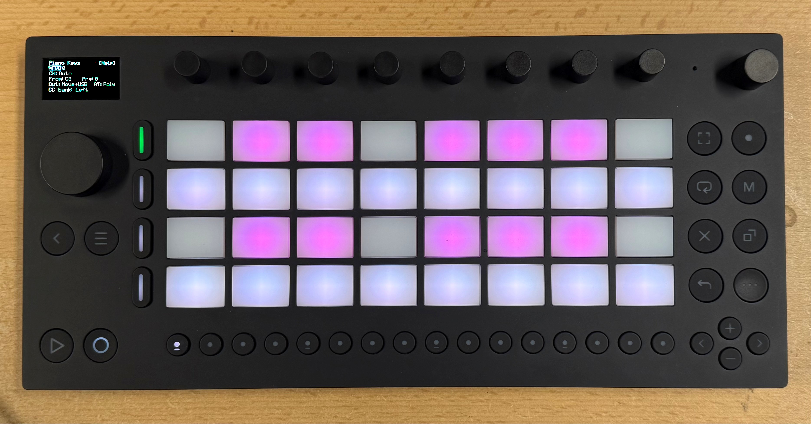

# Piano Keys – Schwung module for Ableton Move

An overtake module that turns the 32 pads into a piano keyboard instead of Move's original in-key / chromatic mode. Works as a simple MIDI controller, can send things even on multiple MIDI channels. Knobs and aftertouch can be set to different CC.

<p align="center">
  
</p>

```
Row 4  C#  D#   –   F#  G#  A#   –   C#     (black, magenta)   upper octave
Row 3  C   D    E   F   G   A    B   C      (white)            upper octave
Row 2  C#  D#   –   F#  G#  A#   –   C#     (black, magenta)   lower octave
Row 1  C   D    E   F   G   A    B   C      (white)            lower octave
```

Unused pads (between E–F and B–C) stay dark. A pressed key lights up green.

## Controls

| Control | Function |
|---|---|
| Track buttons 1–4 | MIDI channel 1–4 (only that channel) |
| Left / Right | Channel: Auto, 1…16 (only that channel) |
| Step buttons 1–16 | Toggle MIDI channels 1–16; notes, aftertouch and knob CCs go to every active channel. Active steps are lit |
| Jog turn | Moves the highlighted (inverted) label: Preset / Ch / From / Prg / Out / AT |
| Jog click | Toggles editing: the value of the highlighted label becomes inverted and the jog changes it (Preset 0–9, Ch, From = lowest note, Prg = program change 0–127 sent on every change, Out, AT = pad pressure Off / Poly / Chan / CC1 / CC2 … CC127, default Chan). Program change and pressure CC are saved. Changing the Preset stores the current settings in the old preset and loads the new one (Ch, From, Prg, Out, AT and the knob CC numbers); no program change is sent on a preset switch, the stored Prg only applies to later changes. The label on screen is "Set:"; the channel list shows "multi" when the channel numbers do not fit |
| Up / Down | Octave (From shifts by 12 semitones) |
| Menu | Output: Move / USB / Move+USB |
| Play / Record | Handled by Move itself (start/stop, record); since Move's LED updates are suppressed while the module runs, the module tracks the transport state and lights the buttons itself (Play green, Record red) |
| Back | Exit the module |
| Knobs 1–8 | Send MIDI CC (default CC 71–78, value 0–127, faster turn = bigger steps) |
| Shift + knob | Reassign that knob's CC number (0–127); nothing is sent |
| Touch knob | Display shows the knob's CC number; turning also shows the value |
| Shift + Volume touch + jog click | Exit (built into Schwung) |

**Auto channel**: the channel of the track selected on Move when the module starts (track N ↔ channel N). During takeover the track buttons belong to the module, so use the track buttons or Left/Right to change the channel. Pressing a step button leaves Auto and selects that channel; further steps add or remove channels (at least one stays on).

**Track selection**: if a Move track's MIDI In channel is "Auto", it plays whatever channel arrives as long as it is the *selected* track. Since the module owns the track buttons, whenever you pick channel 1–4 it presses the matching track button on Move's behalf (and retries until Move reports that track selected), so the sound follows the channel. For best results set the tracks' MIDI In to their own channel (1–4) in Move.

**LEDs**: the module asks Schwung to suppress Move's own LED sysex (`shadow_set_overtake_suppress_sysex`) so the firmware should stop repainting the pads in its in-key/chromatic layout, but also re-sends pad, step and track button LEDs round-robin (1–2 USB-MIDI packets per tick) as a safety net. On Back the module asks Schwung for a native LED repaint (`shadow_set_skip_led_clear`) instead of the usual replay of the pre-start LED state, writes the tracked Play / Record state, then presses the four track buttons on Move's behalf (the selected track last, so the selection does not change) to make Move redraw its pads and track LEDs, and exits ~0.3 s later.

Notes go to Move's own tracks by default (cable-2 injection), so the track listening on the chosen channel plays them. The Menu button also lets you send them to a USB-A device.

**Knob CCs**: they use the same channel and output target as the notes. The 10 presets (channels, From, program, output, pressure mode and CC, knob CC assignments), the active preset and the last knob values are saved to `/data/UserData/schwung/piano-keys/settings.json` and restored on the next start.

## Screen reader

When Schwung's screen reader (TTS) is on, the module announces its state: on start (channel, lowest note, output), on every jog selection and edit, channel and step toggles, octave, output, and knob touch or turn (knob, CC number, value). Pad notes are not announced.

## Installation

```bash
./scripts/install.sh [move.local]   # scp to /data/UserData/schwung/modules/overtake/piano-keys/
./scripts/build.sh                  # dist/piano-keys-module.tar.gz (for Schwung Manager)
```

After installing, restart Schwung and pick "Piano Keys" from the overtake modules.

## Release (install from GitHub in Schwung)

You can install this module from Schwung's web UI with Install Custom Module on the bottom of the Module screen.


## Info

Developed with help of an AI, testing in progress (by human)...